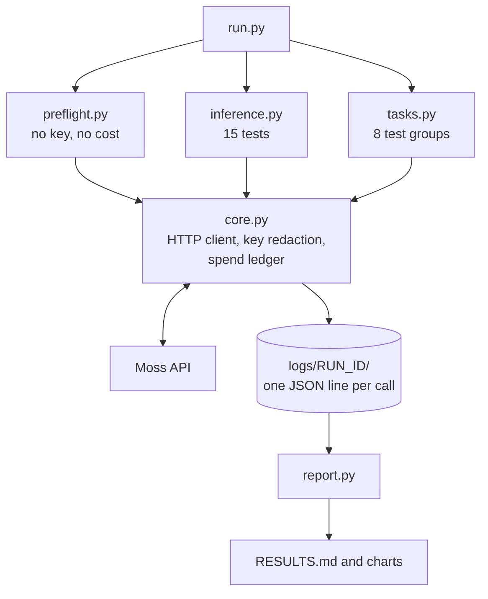
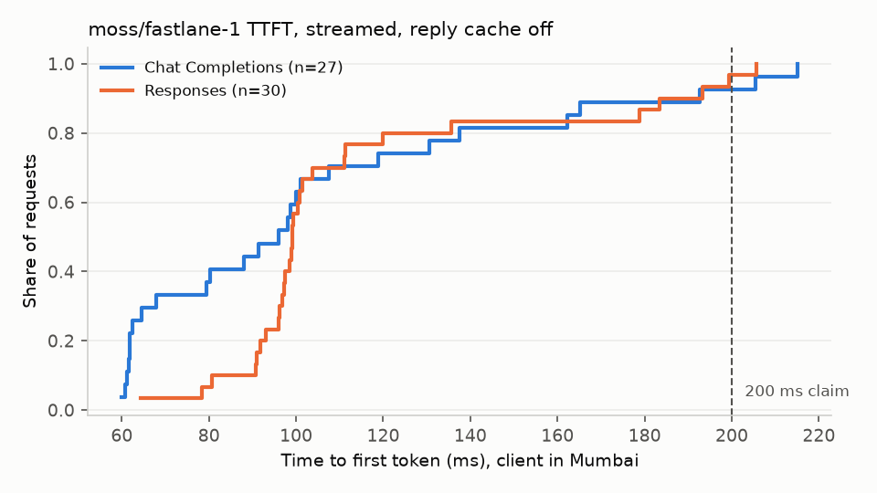

# moss-eval

A test harness for [Moss Inference](https://docs.moss.dev/docs/inference/overview) and its Tasks API, built for the Moss work sample. It checks the API against the docs, measures latency from Mumbai and tries to break the Tasks API. Every HTTP call lands in a JSON log, so you can trace each number to a raw response.

## At a glance

| Area | Result |
| - | - |
| Inference speed | `moss/fastlane-1` first token at 96 ms p50, 202 ms p95 |
| Error handling | 24 of 27 bad requests got the error the docs promise |
| Tasks idempotency | 8 parallel creates with one key made one task |
| Tasks issues | 5 reproduced, listed under [Tasks API](#tasks-api) |
| Spend | $0.25 of the $10 credits |

Raw logs and the full tables: [`logs/20261125-134920`](logs/20261125-134920/RESULTS.md).

## Run it

```bash
python -m venv .venv
.venv/Scripts/pip install -r requirements.txt
cp .env.example .env          # add MOSS_PROJECT_ID and MOSS_PROJECT_KEY
.venv/Scripts/python run.py   # preflight, inference, tasks, report
```

`python run.py tasks --only idempotency,cancel` runs single tests. The run stops when the spend ledger passes `--budget` (default $8).

## How it works



## Inference API

| Measure | Result |
| - | - |
| Streaming TTFT | 96 ms p50, 202 ms p95 (chat); 99 ms p50, 197 ms p95 (responses) |
| Decode speed | 127 tokens/s at p50 |
| Non-stream, 100 tokens | 684 ms p50, 901 ms p99 |
| Prefix cache, 6.9k token prompt | 6400 tokens cached, TTFT 449 ms to 109 ms |
| `temperature: 0` and `json_schema` | 5 of 5 identical outputs; 5 of 5 valid JSON |




The headers advertise `x-ratelimit-limit-requests: 120`, but `remaining` starts at 10, and the eleventh request in a burst gets a 429.

Where the server and the docs disagree:

| Request | Docs | Got |
| - | - | - |
| `/v1/responses`, no key, bad body | 401 | 400 about `input` |
| `/v1/chat/completions`, wrong key, bad body | 401 | 400 `messages is required` |
| `/v1/models`, no key | key required | 200 with all 19 models |
| `/v1/responses` with `"input": ""` | 400 | 200 |
| Body sent as `Content-Type: text/plain` | 400 or 415 | 200 |
| 33 indexes in one call | 400 | 403 `permission_error` |

```bash
curl -s https://inference.moss.dev/v1/responses -H "Content-Type: application/json" -d '{"model":"moss/fastlane-1"}'
# HTTP 400 input must be a string or a list of items (expected 401)
```

## Tasks API


Where it broke:

1. **Schema verification passes a wrong answer.** With the schema `{"n": {"type": "integer", "minimum": 10, "maximum": 5}}`, no value can match. The task ended `completed` with `{"n": 1}` and `verification.passed: true`. The docs say `false`. Repro: `python run.py tasks --only schema_mismatch`.
2. **A start URL that does not load ends `completed`.** The agent put `ERR_SOCKS_CONNECTION_FAILED` into `output_text`, and Moss billed $0.0062. A client that checks `status` reads this as success.
3. **The 20-task queue limit never applied.** I created 23 tasks back to back and got 23 `202 queued`.
4. **Cost reads $0 while a task runs.** At 15 s, `usage.cost.total_usd` was 0.0. After the cancel, the task cost $0.0056. A client cannot enforce its own budget mid-run.
5. **`moss/fastlane-1` as a task model gave a wrong answer.** It said example.com has no heading. `moss-fast` returned `Example Domain` on the same goal.

What held up: 8 parallel creates with one `Idempotency-Key` made one task, and a reused key with another body got `422 idempotency_key_reused`. `max_runtime_seconds: 60` stopped the task at 61 s. Files return `409` until the task ends.


A `401` from `/v1/tasks` takes 312 ms at p50, against 18 ms from `/v1/chat/completions`, and each poll pays that gap. My guess: the Tasks routes run in another region.

## Docs and portal

* The Quickstart says inference has "no included allowance". The signup link gave $10.
* The docs do not mention the `/inference` signup link.
* `docs.usemoss.dev` serves a TLS certificate that expired on 3 Apr 2026.

## Method

* TTFT runs from the request to the first event with text, on home broadband in Mumbai, network included.
* Latency tests send `X-Moss-Cache: off` and a random nonce, so the reply cache cannot answer them.
* The recorder strips `Authorization` and the project key from every log. `tools/check_secrets.py` checks again before a push.
