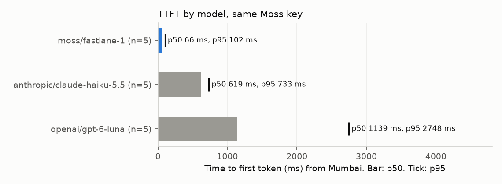
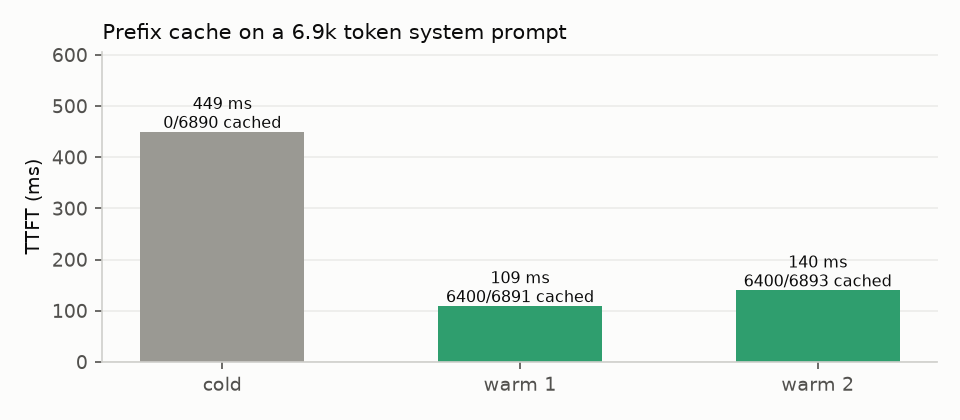
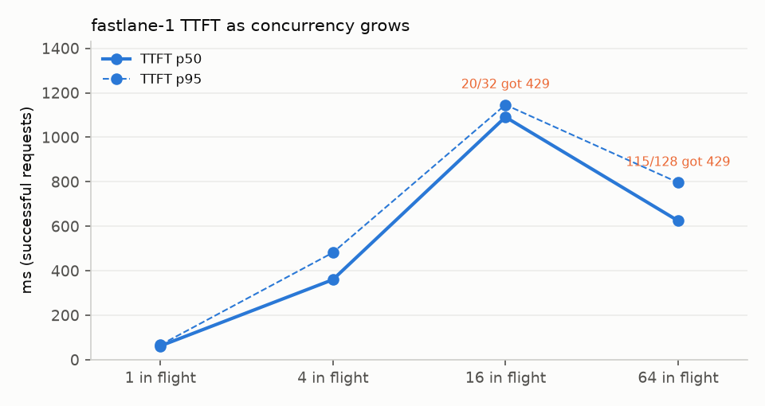
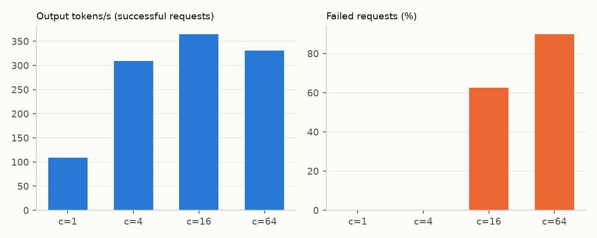
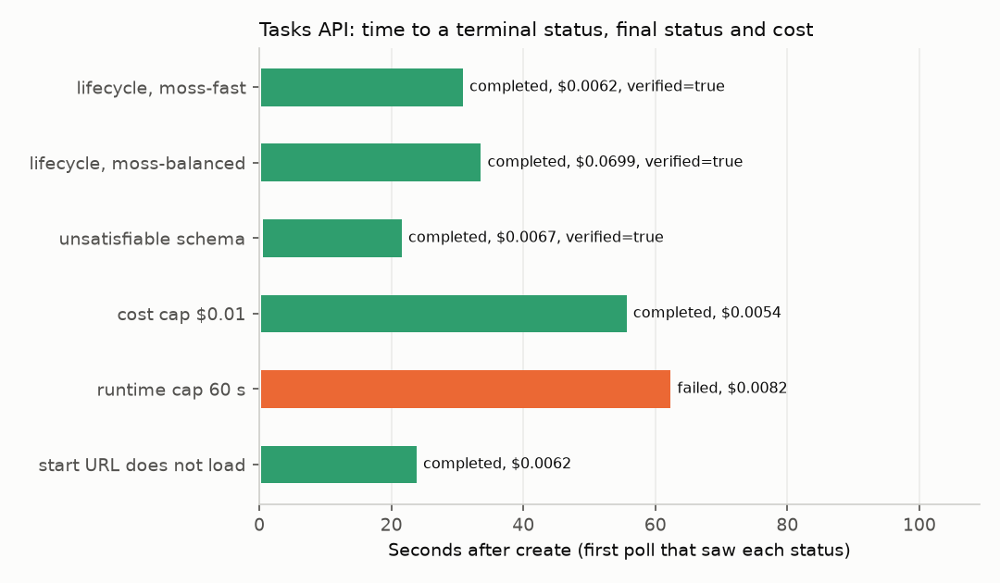
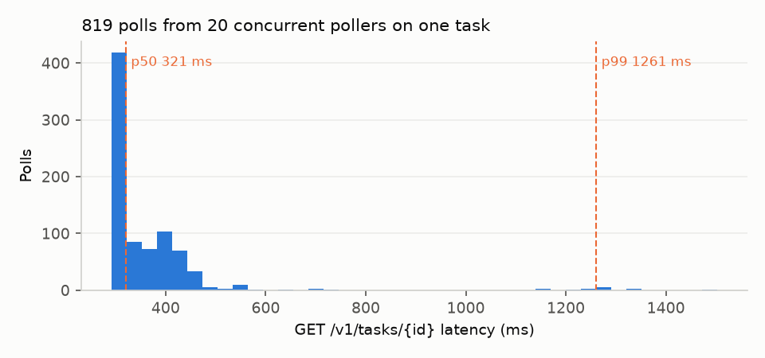
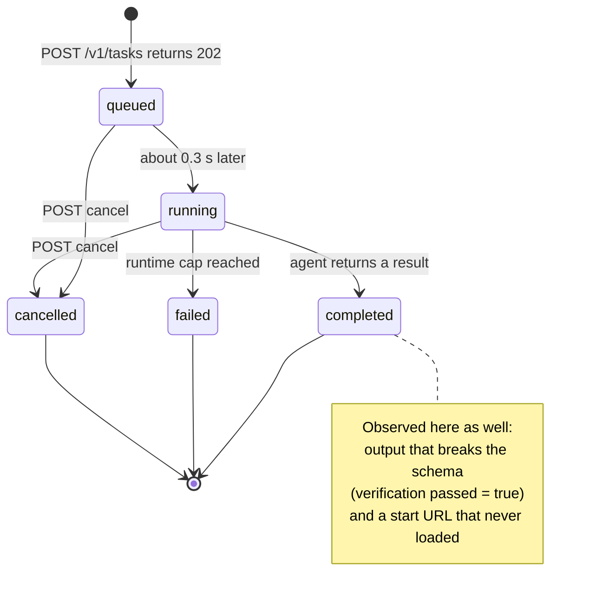
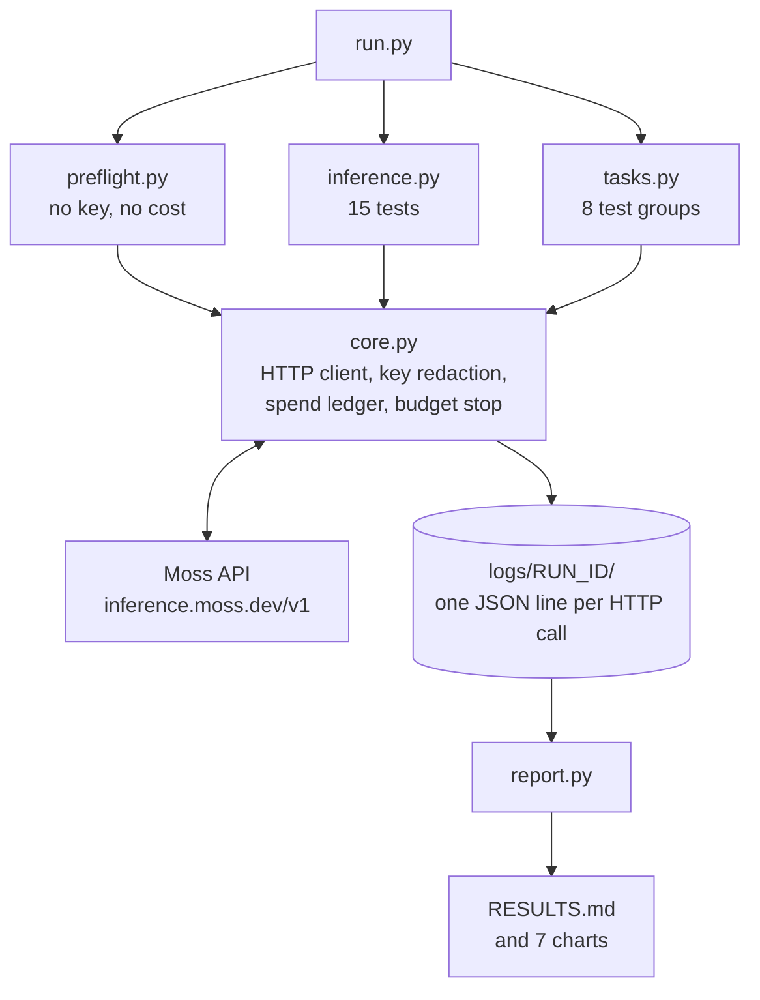

# moss-eval

A test harness for [Moss Inference](https://docs.moss.dev/docs/inference/overview) and its Tasks API. I wrote it for the Moss work sample. It checks the API against the docs, measures latency from my machine in Mumbai, and tries to break the Tasks API. Every HTTP call lands in a JSON log, so you can check each number against the raw response.

## At a glance

| Area | Result |
| - | - |
| Inference speed | `moss/fastlane-1` first token at 96 ms p50, 202 ms p95 from Mumbai |
| Inference error handling | 24 of 27 bad requests got the error the docs promise |
| Tasks idempotency | 8 parallel creates with one key made one task |
| Tasks issues | 5 reproduced, each with a repro step under [Live run results](#live-run-results) |
| Spend | $0.25 of the $10 credits |

## Status

| Stage | Needs a key | State |
| - | - | - |
| `preflight` | no | Ran on 25 Nov 2026. Log: [`logs/20261125-133327`](logs/20261125-133327/RESULTS.md) |
| `inference` | yes | Ran on 25 Nov 2026. Log: [`logs/20261125-134920`](logs/20261125-134920/RESULTS.md) |
| `tasks` | yes | Ran on 25 Nov 2026, 38 tasks. Same log |

Live run total: $0.25 of the $10 credits ($0.03 inference, $0.22 tasks, from each task's own `usage.cost`).

I tested the whole harness against a local fake server (`tools/mock_moss.py`) so the first real run works end to end. The fake server's numbers mean nothing and its logs stay out of git.

## Run it

```bash
python -m venv .venv
.venv/Scripts/pip install -r requirements.txt   # bin/pip on Linux and macOS
cp .env.example .env                             # add MOSS_PROJECT_ID and MOSS_PROJECT_KEY
.venv/Scripts/python run.py                      # preflight + inference + tasks + report
```

Other forms:

```bash
python run.py preflight                          # no key, no cost
python run.py inference --only stream_latency,errors
python run.py tasks --only idempotency,cancel
python run.py report logs/<run>                  # rebuild RESULTS.md and charts
python tools/check_secrets.py                    # before any push
```

Each run writes `logs/<run>/`:

| File | What it holds |
| - | - |
| `preflight.jsonl`, `inference.jsonl`, `tasks.jsonl` | One line per HTTP exchange: request, status, headers, body, timings. Streams keep each event with its arrival time |
| `results.json` | The summary of every test |
| `RESULTS.md` | Tables built from `results.json` |
| `ttft_cdf.png`, `concurrency.png` | Charts built from the logs |

`logs/spend.jsonl` is a ledger of what each call should cost at the [published prices](https://docs.moss.dev/docs/inference/models). The run stops when the ledger passes `--budget` (default $8). Task costs come from each task's own `usage.cost`.

## Budget plan

Every account gets $10 in credits. I sized each test before running it.

| Stage | Worst case | Why |
| - | - | - |
| Inference | about $0.45 | About 400 short calls to `moss/fastlane-1`, plus one 280k token prompt that Moss should reject. If Moss bills it, it costs about $0.14 |
| Tasks | about $1.50 | About 45 tasks. The harness cancels most of them in the queue. Each running one has a `max_cost_usd` cap between $0.01 and $0.20 |
| Total | under $2 | Leaves room to rerun the latency tests |

## What the harness tests

### Inference API

| Test | What it checks |
| - | - |
| `models` | `/v1/models` against the docs table |
| `basic` | Chat Completions and Responses shapes, the deprecated `moss` alias, a call with no `model` |
| `openai_sdk` | The official OpenAI Python SDK: `models.list`, chat, responses, both streams |
| `stream_latency` | 30 streams per API with the reply cache off and unique prompts. TTFT, gap between tokens, decode tokens/s |
| `nonstream_latency` | 60 calls, p50, p95, p99 |
| `caches` | Reply cache on a repeated request; prefix cache with a 6k token system prompt |
| `concurrency` | 1, 4, 16 and 64 requests in flight. Throughput, status codes, `Retry-After` |
| `rate_limit` | A burst of 15 against the documented burst of 10, with the `x-ratelimit-*` headers in order |
| `errors` | 27 bad requests, each beside what the docs say should happen |
| `limits_semantics` | `max_tokens`, `stop`, `max_output_tokens` on a stream, the project system prompt switch |
| `usage_consistency` | `usage` on a stream against the same call without one, and against a local tokenizer |
| `determinism` | `temperature: 0` with and without `seed`, 5 runs each |
| `tools_json` | Function calls, a tool round trip, `tool_choice: required`, tool events on a stream, `json_schema` (5 runs), `json_object` |
| `vendor_compare` | TTFT of `claude-haiku-5.5` and `gpt-6-luna` on the Moss key, next to fastlane |
| `stream_abort` | Drop a stream after 3 events, then check the next call works |

### Tasks API

| Test | What it checks |
| - | - |
| `routes` | Unknown and malformed ids, the files routes, a list route the docs do not mention, a path traversal attempt on file names |
| `validation` | 30 invalid bodies and headers: every documented range plus types, unknown keys, sizes, bad URLs, bad idempotency keys. If one of them creates a task, the harness cancels and flags it |
| `lifecycle` | A task with an `output_schema` on `moss-fast` and `moss-balanced`. Time in each status, files before and after the end, a file download, metadata echo, cancel after finish |
| `schema_mismatch` | A schema no answer can match. Does the task end `completed` with `verification.passed: false`, as the docs say? |
| `idempotency` | Replay, replay with reordered JSON keys, same key with another body, 8 parallel creates with one key, and two creates with no key |
| `cancel` | Cancel while queued, cancel twice, cancel while running. Time to `cancelled` and cost after the cancel |
| `limits` | `max_cost_usd: 0.01` (how far past the cap the spend goes), `max_runtime_seconds: 60`, a start URL that does not resolve, a $50 cap on a $10 balance, a provider key on a `moss-*` model, `moss/fastlane-1` as a task model |
| `queue_and_polling` | Fill the queue past the limit of 20, then 20 pollers on one task for 15 s |

I did not drain the credits to see `usage_limit_exceeded`. That would cost the full $10 and end the test. The run records whether Moss accepts a task cap above the balance.

## Live run results

All numbers come from [`logs/20261125-134920/RESULTS.md`](logs/20261125-134920/RESULTS.md) and the raw JSONL beside it.

### Inference

| Measure | Result |
| - | - |
| Streaming TTFT, `moss/fastlane-1`, chat | p50 96 ms, p95 202 ms (27 of 30; the other 3 hit the burst limit) |
| Streaming TTFT, responses | p50 99 ms, p95 197 ms (30 of 30) |
| Decode speed | about 127 tokens/s at p50 |
| Non-stream, 100 max tokens | p50 684 ms, p95 856 ms, p99 901 ms (n=60) |
| TTFT next to other models on the same key (n=5 each) | fastlane-1 66 ms, `claude-haiku-5.5` 619 ms, `gpt-6-luna` 1139 ms |
| Prefix cache, 6.9k token prompt | 6400 tokens cached on the second call, TTFT 449 ms to 109 ms |
| `temperature: 0`, 5 runs | 5 identical outputs, with and without `seed` |
| `json_schema`, 5 runs | 5 of 5 valid |
| Usage counts | prompt + completion = total on every call; output within 1 token of `o200k_base` |






Concurrency:

| In flight | OK | 429 | TTFT p50 |
| - | - | - | - |
| 1 | 8 of 8 | 0 | 62 ms |
| 4 | 8 of 8 | 0 | 360 ms |
| 16 | 12 of 32 | 20 | 1091 ms |
| 64 | 13 of 128 | 115 | 625 ms |





Headers say `x-ratelimit-limit-requests: 120`, but `remaining` starts at 10, so the real ceiling is the burst of 10.

Server behavior that differs from the docs (`errors` table in RESULTS.md):

| Request | Docs | Got |
| - | - | - |
| `/v1/responses` with `"input": ""` | 400 | 200 |
| Body sent as `Content-Type: text/plain` | 400 or 415 | 200 |
| 33 indexes in one call | 400 | 403 `permission_error` |

The other 24 error cases matched the docs, each with a request id.

### Tasks



The unsatisfiable schema and the dead start URL both end green. Both should end with a failure signal.

Held up:
- 8 parallel creates with one `Idempotency-Key` made one task; 7 came back with the replay flag. The same key with another body got `422 idempotency_key_reused`.
- Files before the end return `409 task_not_finished`; after the end, 5 screenshots listed, and the one I downloaded matched its listed size.
- `max_runtime_seconds: 60` stopped the task at 61 s with `time_limit`.
- 819 polls on one task from 20 pollers: all 200, p50 321 ms, p99 1261 ms.



Broke:

1. **Schema verification passes an answer that breaks the schema.** Schema `{"n": {"type": "integer", "minimum": 10, "maximum": 5}}` (no value can match). The task ended `completed` with output `{"n": 1}` and `verification: {"method": "output_schema", "passed": true}`. The docs say it should end with `passed: false`. Repro: `python run.py tasks --only schema_mismatch`.
2. **A start URL that does not load ends `completed`.** The agent wrote `ERR_SOCKS_CONNECTION_FAILED` into `output_text`, status `completed`, `verification.passed: null`, billed $0.0062. A client checking `status` reads this as success.
3. **The 20-task queue limit did not apply.** I created 23 tasks back to back; all 23 came back `202 queued`, no `429`.
4. **Cost reads $0 while a task runs.** 15 s into a running task, `usage.cost.total_usd` was 0.0. The final cost after cancel was $0.0056 over 5 model calls. A client cannot enforce its own budget mid-run.
5. **`moss/fastlane-1` as a task model gave a wrong answer.** Asked for the main heading of example.com, it said the page has "no heading element". The page has `<h1>Example Domain</h1>`, and `moss-fast` returned it on the same goal.
6. Smaller: `GET /v1/tasks` (not in the docs) returns `200` with an empty body; Moss accepts a `max_cost_usd: 50` cap on a $10 balance.

Task states as the API reported them during the run:



## Findings from the preflight

These come from the no-key preflight. Each one reproduced on every run.

### 1. `/v1/responses` checks the body before it checks for a key

With no `Authorization` header, `/v1/responses` returns `400` about `input`. `/v1/chat/completions` and `/v1/tasks` return `401`. With a valid body, `/v1/responses` returns `401`.

```bash
curl -s https://inference.moss.dev/v1/responses -H "Content-Type: application/json" -d '{"model":"moss/fastlane-1"}'
# {"error":{"message":"input must be a string or a list of items","type":"invalid_request_error",...}}   HTTP 400

curl -s https://inference.moss.dev/v1/chat/completions -H "Content-Type: application/json" -d '{"model":"moss/fastlane-1"}'
# {"error":{"message":"Missing bearer token","type":"authentication_error",...}}   HTTP 401
```

### 2. `/v1/chat/completions` checks the body before it checks the credentials

A well formed but wrong `id:key` gets `400 messages is required` on a bad body, and `401 The project credentials were rejected` on a good one. `/v1/tasks` rejects the credentials first. Anyone can read the validation rules without an account, and a client with a revoked key and a body bug sees the body error first. It also means a 400 tells you nothing about whether your key works.

```bash
curl -s https://inference.moss.dev/v1/chat/completions -H "Authorization: Bearer proj_000:key_000" \
  -H "Content-Type: application/json" -d '{"model":"moss/fastlane-1"}'
# HTTP 400 messages is required
```

### 3. `/v1/models` needs no key

The docs show the call with a bearer token. It returns `200` and all 19 models with no header and with a wrong key. Model ids are public, so this leaks nothing. The docs should drop the token, or the server should check it.

### 4. The Tasks control plane sits far from the inference edge

A `401` from `/v1/chat/completions` comes back in 18 ms at p50 from Mumbai (43 ms p95, n=19). The same `401` from `/v1/tasks` takes 312 ms at p50 (491 ms p95). The headers differ too: chat goes through three Caddy hops and carries `x-moss-box`, tasks through one. My guess is a different region. A client that polls every 2 s pays about 0.3 s per poll before Moss does any work.

### 5. Smaller things

* `GET` with a body on any route gets an HTML `400` page from the Google load balancer instead of the JSON error shape. Standard HTTP clients do not send a body on `GET`.
* `docs.usemoss.dev` serves a TLS certificate that expired on 3 Apr 2026 and then a 404. The live docs moved to `docs.moss.dev`, and nothing links to the old host. The old host keeps resolving.
* The Quickstart says inference has "no included allowance" and to buy at least $5 of credits first. The signup link Moss sent gives $10. A new user who reads the docs first would think they have to pay.
* The overview says Inference is in private beta and links to the portal root to request access. The docs do not mention the `/inference` link that grants access.

## Layout



```text
run.py                 one command for every stage
moss_eval/core.py      HTTP client, JSON recorder, key redaction, spend ledger
moss_eval/preflight.py no-key probes
moss_eval/inference.py Inference API tests
moss_eval/tasks.py     Tasks API tests
moss_eval/report.py    RESULTS.md and charts
tools/mock_moss.py     local fake server for dry runs
tools/check_secrets.py scans tracked files for the key
logs/                  raw logs, one folder per run
```

## Notes on method

* TTFT is the time from sending the request to the first event that carries text, measured on my laptop in Mumbai on home broadband. It includes the network. The preflight `401` round trip gives the network floor, so you can subtract it.
* Latency tests send `X-Moss-Cache: off` and a random nonce in each prompt, so the reply cache cannot answer them.
* The concurrency sweep waits 65 s between levels so each level starts with a fresh per-minute window.
* The recorder strips `Authorization` from logs and replaces the project id and key anywhere they appear. `tools/check_secrets.py` checks again before a push.
